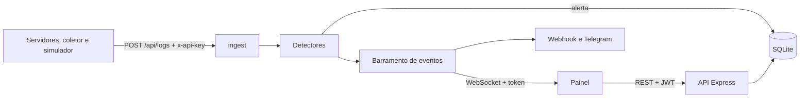

# Mini SOC


Painel de operações de segurança que detecta ataques em tempo real. Recebe eventos de login e de acesso a portas, aplica regras de detecção e mostra tudo num painel ao vivo, com investigação, bloqueio de IPs, login por perfil e trilha de auditoria.

**Demonstração online:** adicione aqui o link do GitHub Pages (`https://lauradeola.github.io/mini-soc/frontend/`). Ela roda com tráfego simulado no navegador, sem servidor.

<!-- Coloque aqui os prints do painel:  -->

## O que ele faz

**Detecção** (regras ajustáveis pela interface, cada alerta com a técnica MITRE ATT&CK)

| Regra | Dispara quando | MITRE |
|---|---|---|
| Força bruta | muitas falhas de login do mesmo IP | T1110 |
| Credential stuffing | o mesmo IP tenta usuários diferentes | T1110.004 |
| Acesso após falhas | falhas seguidas de um login que funcionou na mesma conta | T1078 |
| Varredura de portas | o mesmo IP toca várias portas | T1046 |
| Login de novo IP | uma conta com histórico entra de um IP que nunca usou | T1078 |
| Login fora do horário | login bem-sucedido fora do expediente (desligada por padrão) | T1078 |

**Investigação e resposta:** pontuação de risco por IP, incidentes (alertas do mesmo IP agrupados), histórico e notas por alerta, bloqueio manual ou automático com prazo, lista de IPs protegidos, ficha do IP com reputação e país (opcionais), exportação CSV e relatório para impressão.

**Segurança do próprio painel:** login com perfis (administrador e analista), JWT com renovação, conta travada após 5 senhas erradas, encerrar todas as sessões, chave de API por fonte de logs, auditoria no servidor. Veja o [modelo de ameaças](docs/THREAT_MODEL.md).

**Operação:** logs estruturados em JSON, métricas Prometheus, backup diário do banco, retenção de dados, encerramento limpo e Docker.

## Arquitetura



```
mini-soc/
├── backend/     API Express, detectores, SQLite, WebSocket e testes
├── frontend/    Painel (index.html + css/ + js/)
├── collector/   Coletor de logs do SSH (só Node, sem dependências)
├── e2e/         Testes de ponta a ponta no navegador (Playwright)
├── docs/        Modelo de ameaças, OpenAPI e rascunho de post
├── Dockerfile, docker-compose.yml, render.yaml
└── .github/workflows/ci.yml
```

## Rodando localmente

```bash
cd backend
cp .env.example .env     # defina API_KEY e, se quiser, JWT_SECRET e as senhas
npm install
npm run dev
```

Na primeira execução o servidor cria os usuários `admin` e `analista`. Se `ADMIN_PASSWORD` e `ANALYST_PASSWORD` estiverem vazias, as senhas são geradas e **mostradas uma única vez no terminal**.

Abra `http://localhost:3000`. Também funciona abrindo `frontend/index.html` com o Live Server do VS Code: o painel descobre sozinho se há servidor e, sem ele, roda em modo demonstração.

## Dados reais: o coletor de logs

```bash
cd collector
API_KEY=sua-chave node tail-log.js /var/log/auth.log
API_KEY=sua-chave node tail-log.js samples/auth.log --replay   # teste sem servidor SSH
```

Para cada servidor, crie uma chave própria na tela **Fontes de logs** (o painel mostra a chave uma única vez) e revogue quando quiser.

## Configuração (`backend/.env`)

| Variável | Para que serve |
|---|---|
| `API_KEY` | chave de quem envia logs (alternativa: uma chave por fonte no painel) |
| `JWT_SECRET`, `ADMIN_PASSWORD`, `ANALYST_PASSWORD` | login do painel |
| `ALLOWLIST` | IPs que nunca podem ser bloqueados |
| `WORK_HOURS` | expediente da regra "fora do horário" (ex.: `07-20`) |
| `WEBHOOK_URL`, `TELEGRAM_BOT_TOKEN`, `TELEGRAM_CHAT_ID` | avisos de alertas altos e críticos |
| `ABUSEIPDB_KEY`, `GEOIP_DB` | reputação e país na ficha do IP |
| `LOG_LEVEL`, `RETENTION_DAYS`, `BACKUP_DIR`, `METRICS_TOKEN` | operação |
| `SIMULATE` | liga o simulador e os botões de simulação |

As regras e a resposta automática ficam salvas no banco: o que você ajustar na tela continua depois de reiniciar.

## Testes

```bash
cd backend && npm test                    # detectores, resposta, autenticação e API
node --test collector/*.test.js           # parser de logs
cd e2e && npm install && npx playwright install chromium && npm test   # navegador
```

## API

Documentada em [`docs/openapi.yaml`](docs/openapi.yaml). Cole o arquivo em https://editor.swagger.io para navegar pelos 22 endpoints. As rotas de administração exigem o perfil de administrador no servidor.

## Docker e publicação

```bash
cp backend/.env.example backend/.env
docker compose up --build        # http://localhost:3000, dados em um volume
```

`render.yaml` publica no Render a partir do Dockerfile. Em produção use HTTPS, defina `JWT_SECRET` e desligue `SIMULATE`.

## Operação

- Métricas Prometheus em `/metrics` (só com `METRICS_TOKEN`, enviado como `Authorization: Bearer`)
- Backup diário em `BACKUP_DIR`, com as últimas 7 cópias
- `SIGTERM` e `SIGINT` encerram as conexões e fecham o banco antes de sair

## Limites conhecidos

O bloqueio vive dentro do sistema: para barrar o tráfego de verdade, um firewall precisa ler a lista. Não há 2FA, e os detectores por limiar não pegam ataques lentos e distribuídos. A lista completa está no [modelo de ameaças](docs/THREAT_MODEL.md).

## Licença

MIT. Veja [LICENSE](LICENSE). Para reportar uma vulnerabilidade, veja [SECURITY.md](SECURITY.md).
